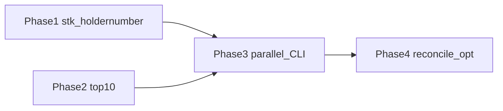

# ROADMAP — Shareholder reference sync

**Milestone:** fina_indicator 扩展（stk_holdernumber + top10 ×2）  
**Granularity:** coarse  
**Updated:** 2026-04-19

## Phase overview

| # | Phase | Goal | Requirements | Success criteria |
|---|--------|------|--------------|------------------|
| 1 | stk_holdernumber 管道 | 公告区间拉取、落库、并入增量季逻辑 | SHARE-01, SHARE-02, SHARE-03 | ① 表存在且 UPSERT；② 分页 3000 无静默截断；③ 空表/非空表季列表与五表一致 |
| 2 | top10 双表管道 | 按票 + 报告期区间、分页切段 | TOP10-01, TOP10-02, TOP10-03 | ① 两表结构与唯一键正确；② stock_basic 驱动循环；③ 超限时切段不重不漏 |
| 3 | 并行编排与运维开关 | 八线程阶段1、TRUNCATE、skip-reference | ORCH-01, ORCH-02, ORCH-03, QUAL-01 | ① Executor≥8 + 可中断 wait；② ALL_SYNC 含三表；③ CLI 开关可用；④ 时间戳与注释合规 |
| 4 | （可选）核对与收尾 | stk_holdernumber 季条数 reconcile | QUAL-02 | 至少一季可与 API 行数对齐或在文档注明限制 |

---

## Phase 1: stk_holdernumber

**Goal:** `stock_tushare.stk_holdernumber` 可从 Tushare 稳定同步，季策略与 `fina_indicator` 对齐。

**Requirements:** SHARE-01, SHARE-02, SHARE-03

**Success criteria:**

1. `pro.query('stk_holdernumber', ...)` 带全字段 `fields`，`limit=3000` 分页直至结束。
2. `period → (start_date,end_date)` 映射函数可测（日历季或披露启发，代码注释说明）。
3. 首次空表跑 `get_all_quarters()` 映射的公告窗覆盖历史；非空表仅 `_compute_incremental_periods` 窗口。

**UI hint**: no

---

## Phase 2: top10_holders / top10_floatholders

**Goal:** 两表自动建表、按票批量区间拉取、唯一键 UPSERT。

**Requirements:** TOP10-01, TOP10-02, TOP10-03

**Success criteria:**

1. 显式 `fields`；`_normalize_extra_df` 路径与现并列表一致。
2. 每票 `start_date`/`end_date` 覆盖本批 `periods` 的 min-max；超限按年拆分。
3. `top10_holders` 与 `top10_floatholders` 逻辑复用同一套私有工具，避免重复。

**UI hint**: no

---

## Phase 3: 并行编排与 CLI

**Goal:** 阶段1 扩展为 8 路并行；危险清表与跳过参考表一致。

**Requirements:** ORCH-01, ORCH-02, ORCH-03, QUAL-01

**Success criteria:**

1. `_run_parallel_*` 提交 8 个 worker（或等价），`KeyboardInterrupt` 路径仍 `shutdown(wait=False, cancel_futures=True)`。
2. `ALL_SYNC_TABLE_NAMES` 追加三表；`--truncate-and-full-sync` 文案更新为「八表」。
3. 新增 `--skip-reference`（命名以最终实现为准）与头文件说明。

**UI hint**: no

---

## Phase 4: （可选）reconcile

**Goal:** SHARE 表按 `end_date=period` 条数核对或记录限制。

**Requirements:** QUAL-02

**Success criteria:**

1. 至少实现 `stk_holdernumber` 与源行数比对；或 REQUIREMENTS 中标注「延后」理由。

**UI hint**: no

---

## Requirement traceability

| REQ ID | Phase |
|--------|-------|
| SHARE-01..03 | 1 |
| TOP10-01..03 | 2 |
| ORCH-01..03, QUAL-01 | 3 |
| QUAL-02 | 4 |

---

## Dependencies

Phase 1 与 2 可顺序或子分支并行开发，**合并前须通过 Phase 3 集成**。
